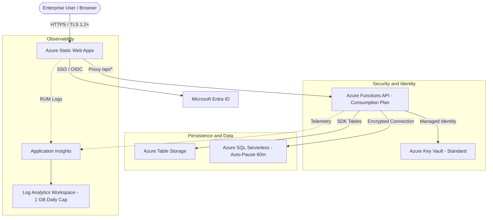

# Technical Architecture and Engineering Manual

> **Purpose:** Master technical document for software architects, DevOps engineers, developers, and infrastructure security auditors. Outlines the overall architecture, design patterns, interface specifications, cloud automation (IaC), FinOps controls, local emulation, and security governance implemented in Atlas_AI.

---

## 1. Overview and Architectural Principles

The Atlas_AI system implements a cloud-native, decoupled, event-driven architecture designed to provide high availability, enterprise-grade security, and near-zero cost at rest.

### Core Guiding Principles
1. **Serverless-First and Pay-per-Use:** Compute scales to zero instances during idle periods, eliminating idle infrastructure overhead.
2. **API-First Architecture:** All services expose formal REST contracts documented under OpenAPI 3.1 before implementing business logic.
3. **Zero-Trust Security and NIST CSF 2.0:** No component implicitly trusts another. Inter-service access is governed by System-Assigned Managed Identities, and user authentication is delegated to Microsoft Entra ID via OIDC/OAuth 2.0.
4. **Active FinOps Governance:** Infrastructure enforces automatic auto-pause policies, daily ingestion caps on logging, and mandatory cost allocation tagging.



---

## 2. Technology Tier Breakdown

### A. Frontend and Web Delivery Tier
- **Cloud Service:** Azure Static Web Apps (SWA).
- **Configuration Path:** [`patterns/ux-patterns/staticwebapp.config.json`](file:///c:/Sources/Atlas_AI/patterns/ux-patterns/staticwebapp.config.json).
- **Key Characteristics:**
  - Global edge distribution (Edge CDN) with native HTTPS and automated SSL certificate management by Microsoft.
  - SPA routing (*Single Page Application Fallback*) to `/index.html` excluding `/api/*` routes and static assets.
  - Hardening HTTP security headers:
    - `Content-Security-Policy`: Restricts script and style execution to self and authorized Microsoft Entra ID endpoints.
    - `X-Frame-Options: DENY`: Prevents Clickjacking attacks completely.
    - `Strict-Transport-Security`: Enforces HSTS with preload and subdomains (`max-age=31536000`).
    - `X-Content-Type-Options: nosniff`.

### B. Compute and Business Logic Tier (Backend APIs)
- **Cloud Service:** Azure Functions v4 (Linux, Node.js 20, Python 3.11, or .NET 8).
- **Hosting Plan:** Consumption Plan (`Y1 / Dynamic`), billed per execution and second.
- **Key Characteristics:**
  - Zero cost at rest ($0.00 USD when there are no active requests).
  - Elastic automatic scaling from 0 to 200 concurrent instances on demand.
  - Native integration with SWA via integrated proxy routing (`/api/*`), removing the need for manual CORS configuration in production.
  - **System-Assigned Managed Identity** for interacting with Azure Key Vault and SQL Database without storing credentials in application settings or environment variables.

### C. Identity and Access Layer (UXP-05 Pattern)
- **Cloud Service:** Microsoft Entra ID (formerly Azure Active Directory).
- **Protocol:** OpenID Connect (OIDC) / OAuth 2.0 Authorization Code Flow with PKCE.
- **Authentication Flow:**
  1. The user accesses a protected route or clicks `/login`.
  2. SWA intercepts the request and redirects to `/.auth/login/aad`.
  3. Entra ID validates enterprise credentials, evaluates Conditional Access policies, and prompts for MFA.
  4. Entra ID issues the token and redirects back to the SWA callback (`/.auth/login/aad/callback`).
  5. SWA sets an encrypted session cookie `AppServiceAuthSession` (HTTP-Only, Secure, SameSite=Lax).
  6. On every call to `/api/*`, SWA injects the `x-ms-client-principal` header encoded in Base64 containing the user identity, claims, and assigned roles.

### D. Persistence and Caching Tier
- **Azure Table Storage (Standard LRS Hot):** Ultra-low latency NoSQL key-value store for application entities, sessions, and metadata. Locally redundant (LRS) to minimize costs in dev and standard production environments.
- **Azure SQL Database Serverless (GP_S_Gen5):**
  - Minimum: `0.5 vCore` -- Maximum: `1.0 vCore` (dev) / `2.0 vCore` (prod).
  - **Auto-Pause Delay at 60 minutes:** Suspends compute automatically after 60 minutes of inactivity, saving up to 75% compared to continuously provisioned databases.
- **Azure Key Vault (Standard):**
  - Centralized key and secret management using the Azure RBAC model (`Key Vault Secrets User`).
  - Strict policy prohibiting secrets in source code and a formal rotation protocol ([`docs/reference/secret-handover-ceremony.md`](file:///c:/Sources/Atlas_AI/docs/reference/secret-handover-ceremony.md)).

### E. Observability and Monitoring Tier
- **Application Insights + Log Analytics Workspace:**
  - Log retention: 30 days (no historical archive charges).
  - Daily Ingestion Cap (*Daily Cap*): 1.0 GB per day to prevent runaway billing caused by error loops.
  - KQL diagnostic queries for monitoring HTTP 5xx error rates and p95 latency documented in [`docs/reference/operations-runbook.md`](file:///c:/Sources/Atlas_AI/docs/reference/operations-runbook.md).

---

## 3. Interface Specifications and OpenAPI Contract

The system operates under a strict **API-First** posture. The formal contract definition resides in [`docs/reference/openapi-starter.yaml`](file:///c:/Sources/Atlas_AI/docs/reference/openapi-starter.yaml):

### Universal Platform Endpoints
| Method | Path | Description | Access Level | Response Format |
| :--- | :--- | :--- | :--- | :--- |
| `GET` | `/api/v1/health` | Health probe (Liveness / Readiness probe) | Public / Anonymous | `{ "status": "healthy", "timestamp": "...", "version": "1.0.0" }` |
| `GET` | `/api/v1/version` | Version and deployment commit info | Public / Anonymous | `{ "version": "1.0.0", "environment": "dev", "buildCommit": "..." }` |
| `GET` | `/api/v1/items` | Paginated listing of domain entities | Requires Bearer Token | `{ "items": [...], "nextCursor": "...", "hasMore": false }` |
| `POST` | `/api/v1/items` | Entity creation with idempotency support | Requires Bearer Token | HTTP 201 Created with `Location` header |

### Standard Error Responses (RFC 7807)
All 4xx and 5xx error responses return `Content-Type: application/problem+json`:
```json
{
  "type": "https://api.company.com/errors/validation-error",
  "title": "Validation Error",
  "status": 400,
  "detail": "The 'name' field is required and must not exceed 100 characters.",
  "instance": "/api/v1/items",
  "invalidParams": [
    { "name": "name", "reason": "Must be between 1 and 100 characters." }
  ]
}
```

---

## 4. Infrastructure as Code (IaC) and Deployment

Infrastructure is provisioned using modular templates in **Azure Bicep**:

- **Master Template:** [`infra/main.bicep`](file:///c:/Sources/Atlas_AI/infra/main.bicep)
- **Parameters:** [`infra/parameters.dev.json`](file:///c:/Sources/Atlas_AI/infra/parameters.dev.json) and [`infra/parameters.prod.json`](file:///c:/Sources/Atlas_AI/infra/parameters.prod.json)
- **Deployment Command:**
  ```powershell
  az deployment group create `
    --resource-group rg-atlas-dev-eastus `
    --template-file infra/main.bicep `
    --parameters @infra/parameters.dev.json
  ```
- **CI/CD Pipeline:** Defined in [`.github/workflows/azure-deploy.yml.template`](file:///c:/Sources/Atlas_AI/.github/workflows/azure-deploy.yml.template) using OpenID Connect (OIDC / Federated Credentials) to connect GitHub Actions to Azure without long-lived credentials in repository secrets.

---

## 5. Local Emulation Environment (Offline Dev)

To run the system locally at zero cloud cost:
1. Verify prerequisites:
   ```powershell
   pwsh scripts/dev-local.ps1 -CheckOnly
   ```
2. Launch the unified local environment:
   ```powershell
   pwsh scripts/dev-local.ps1 -StartAzurite
   ```
3. The local reverse proxy activates on `http://localhost:4280`, offering Entra ID SSO emulation at `/.auth/login/aad` and persistence emulation in Azurite without requiring an active internet connection.

---

## 6. Automated Verification Procedure (Smoketest)

Upon completing any development task or deployment, execute the automated verification probe:
```powershell
pwsh scripts/smoketest.ps1 -BaseUrl http://localhost:4280
```
The script validates service liveness, metadata, and 401 unauthenticated boundary enforcement on protected endpoints, emitting exit code `0` on success or `1` on failure.
